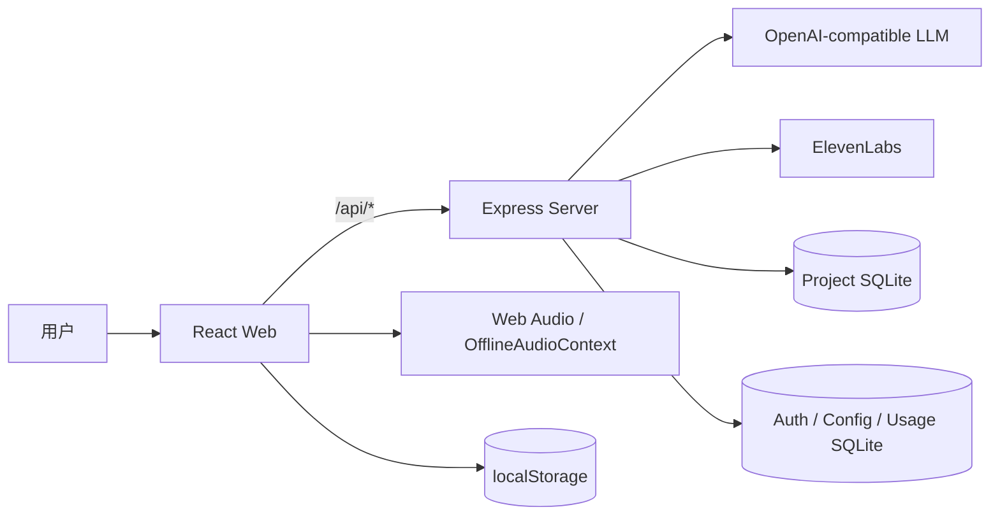
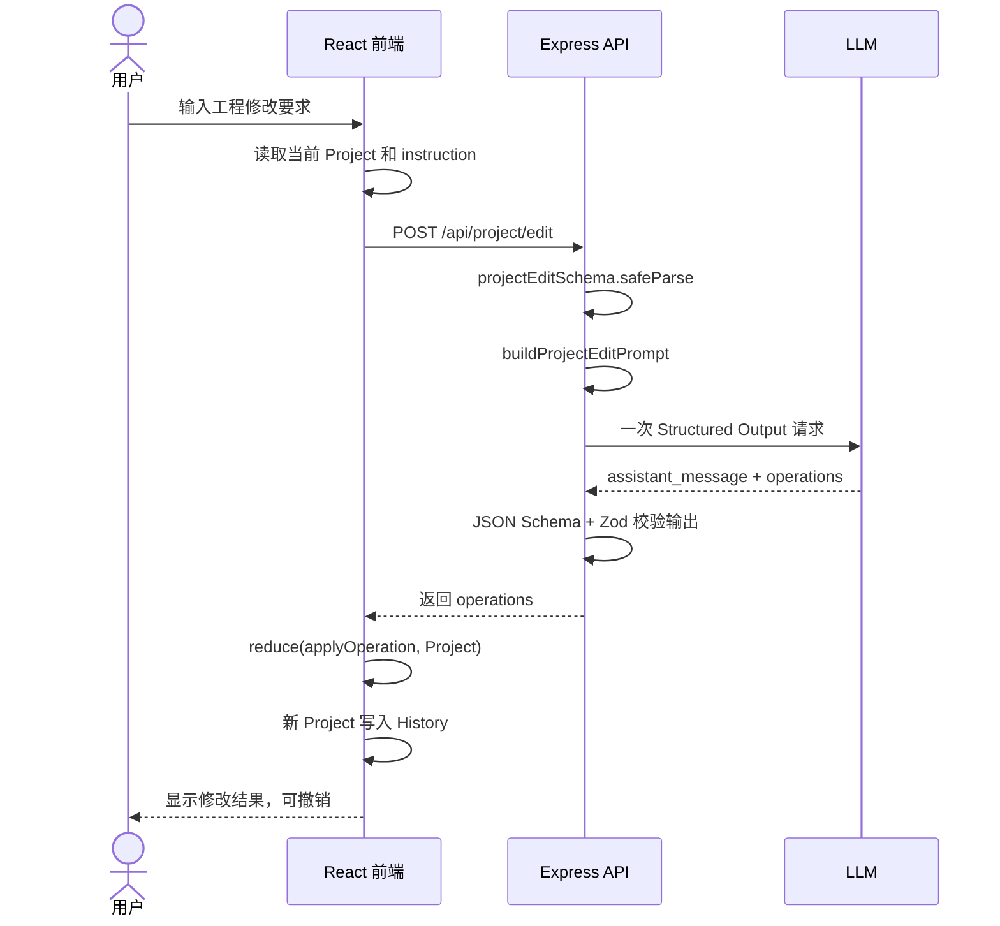
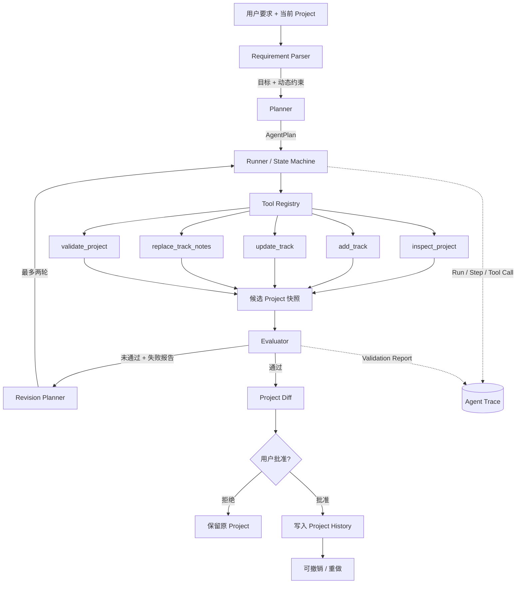

# Sonic / Matter 当前 Agent 架构与升级边界

> 日期：2026-10-29  
> 阶段：20 天学习与项目优化计划 · Day 1  
> 目标：说明当前系统怎样使用 LLM、为什么它仍属于 Agent 原型，以及第一阶段准备把哪一条链路升级为可执行、可验证、可审阅的 Agent。

## 1. 项目当前定位

Sonic / Matter 是一个把游戏概念、声音方向和自然语言修改要求转成可编辑音乐工程的全栈 Web 应用。它已经具备结构化模型调用、工程编辑、音频渲染、云端工程、账户和生成服务保护能力。

当前与 Agent 最相关的四条接口是：

| 接口 | 输入 | 输出 | 当前行为 |
| --- | --- | --- | --- |
| `POST /api/concept/interpret` | 游戏资料、声音方向、概念焦点 | 三种概念解释和音乐叙事 | 单次结构化 LLM 调用；无 Key 时使用本地 fallback |
| `POST /api/project/edit` | 当前 Project、用户修改要求 | 工程操作数组 | 单次结构化 LLM 调用；前端立即应用操作 |
| `POST /api/sfx/plan` | 音效描述、语义调音台参数 | 结构化音效计划 | 单次结构化 LLM 调用；无 Key 时使用本地 fallback |
| `POST /api/music/plan` | 当前 Project、音乐提示 | MIDI/和弦工程计划 | 单次结构化 LLM 调用；无 Key 时沿用本地工程结构 |

这些能力比普通聊天接口可靠，但都采用“输入一次、调用模型一次、返回结果一次”的请求模式。第一阶段只选择 `/api/project/edit` 对应的“自然语言修改当前工程”作为 Agent 升级主线。

## 2. 当前系统边界



### 前端职责

- 保存当前 `Project` 和编辑历史。
- 收集游戏资料、声音方向和 Agent 指令。
- 通过统一 API 客户端调用后端。
- 应用模型返回的工程操作。
- 播放、编辑和导出 MIDI、WAV、MP3。
- 展示云端工程、账户和服务配置状态。

### 后端职责

- 验证 HTTP 输入。
- 解析 Agent 配置并调用模型。
- 使用 JSON Schema 和 Zod 验证模型输出。
- 调用可选的平台真实音效服务。
- 管理工程、账户、平台密钥和生成额度。
- 返回统一错误信封并记录脱敏日志。

### LLM 当前职责

- 理解游戏和声音语义。
- 生成结构化概念解释、音乐计划和音效计划。
- 根据用户指令提出工程操作。

LLM 不会直接修改 React State、SQLite 数据或浏览器音频工程。真正的数据变更仍由普通 TypeScript 代码执行。

## 3. `/api/project/edit` 当前数据流

### 3.1 主流程



### 3.2 对应代码位置

| 环节 | 当前实现 |
| --- | --- |
| 前端组装并发起 Agent 请求 | [`web/src/App.tsx`](../../web/src/App.tsx) 中的 `agentRequest`、`editProject` |
| 统一请求、超时、取消和错误翻译 | [`web/src/api/client.ts`](../../web/src/api/client.ts) |
| 后端工程编辑路由 | [`server/src/index.ts`](../../server/src/index.ts) 中的 `/api/project/edit` |
| Project 的后端输入 Schema | [`server/src/projectSchema.ts`](../../server/src/projectSchema.ts) |
| 模型 Structured Output 调用 | [`server/src/index.ts`](../../server/src/index.ts) 中的 `structuredResponse` |
| 工程编辑 Prompt | [`server/src/musicPrompt.ts`](../../server/src/musicPrompt.ts) |
| 前端 Project / Track / Note 类型与归一化 | [`web/src/project/model.ts`](../../web/src/project/model.ts) |
| 轨道、音符和历史的确定性逻辑 | [`web/src/project/`](../../web/src/project/) |

### 3.3 当前操作的真实执行者

模型返回的是操作描述：

```json
{
  "assistant_message": "已增加低音轨。",
  "operations": [
    {
      "type": "add_track",
      "instrument": "bass"
    }
  ]
}
```

这段 JSON 本身不会修改工程。前端收到响应后，才通过 `applyOperation` 把操作折叠到当前 Project，并将结果写入历史记录。

因此当前系统已经分离了“模型提出修改”和“程序真正修改”，但还没有把修改能力抽象成统一、可审计的 Tool Registry。

## 4. 三层正确性

当前升级必须明确区分三种验证。

### 4.1 数据格式正确

由 JSON Schema 和 Zod 检查：

- 字段是否存在。
- 字段类型是否正确。
- 字符串、数组和数值是否越界。
- 操作类型是否属于允许集合。

示例：`instrument: null` 或 `type: 123` 应在这一层被拒绝。

### 4.2 工程结构正确

由 Project Schema 和确定性业务代码检查：

- 轨道和音符结构是否合法。
- 音符是否超出工程时间范围。
- 轨道 ID 是否冲突。
- 工程是否仍可播放、保存和导出。

### 4.3 用户任务正确

由未来的 Evaluator 检查：

- 用户要求的低音轨是否真的存在。
- 用户禁止的鼓组是否没有出现。
- 工程是否保持在 30 秒以内。
- 后半段音符密度是否高于前半段。

Schema 合法不能证明任务完成。例如 `drums` 是系统支持的合法乐器，但在某一次“不要使用鼓组”的任务中会违反动态约束。

```text
数据格式正确
      ↓
工程结构正确
      ↓
用户任务正确
```

## 5. 当前已经具备的 Agent 基础

### 结构化模型边界

- 模型输出使用 JSON Schema Structured Outputs。
- 输出继续经过 Zod 二次校验。
- Project 输入由后端 Schema 保护。

### 可靠请求层

- 支持超时和 `AbortSignal` 取消。
- 统一解析错误信封。
- 对网络、限流、上游超时和非法响应提供稳定错误码。

### 确定性业务能力

- 已有轨道、音符、片段和工程归一化逻辑。
- 已有撤销/重做 History。
- 已有 MIDI 导出和 Web Audio 渲染能力。
- 已有大量纯逻辑单元测试，可复用为 Agent 工具基础。

### 安全与资源保护

- 平台密钥由服务端加密保存。
- 付费服务有认证、日额度、频率和并发限制。
- 日志和错误响应避免泄漏密钥。

这些能力应被复用，而不是为了引入 Agent 框架重新实现一套平行系统。

## 6. 为什么当前仍属于 Agent 原型

### 6.1 没有显式计划

模型直接返回工程操作，没有独立的目标、动态约束、步骤和成功条件。执行前无法审阅，也难以解释为什么选择这些操作。

### 6.2 没有统一工具注册表

当前 `operations` 已具有工具调用雏形，但缺少统一的工具名、输入 Schema、输出 Schema、权限、超时、错误分类和调用记录。

### 6.3 没有运行状态机

当前主要表现为请求进行中、成功或失败，没有 `planning`、`executing`、`validating`、`revising`、`awaiting_approval` 等可审计状态。

### 6.4 没有任务级验收

Schema 可以证明数据形状合法，却不能证明结果满足这次用户的动态要求。

### 6.5 没有自动修订

第一次输出违反要求时，系统不能根据失败报告自动生成有限的修订计划。

### 6.6 没有执行前审阅

操作校验成功后会直接进入 Project History。用户可以撤销，但无法在应用前查看计划、工具调用、验收报告和 Project Diff。

### 6.7 没有 Run 级 Trace

当前没有一个稳定的 Run ID 串联计划、步骤、工具调用、验证和修订，也无法用统一数据计算 Agent 成功率和失败分布。

## 7. 目标 Agent 架构



## 8. 目标组件职责

| 组件 | 负责 | 不负责 |
| --- | --- | --- |
| Requirement Parser | 从自然语言提取目标和动态约束 | 修改 Project |
| Planner | 生成工具步骤和验收条件 | 直接执行工具 |
| Runner | 状态、步骤预算、超时、取消、错误和终止 | 判断音乐语义是否优美 |
| Tool Registry | 白名单、参数验证、工具执行和结果记录 | 接受任意模型生成代码 |
| Project Validator | 检查工程结构和业务不变量 | 判断是否满足用户动态需求 |
| Evaluator | 检查用户约束是否满足 | 修改工程 |
| Revision Planner | 根据失败项生成有限修订步骤 | 无限重复尝试 |
| Project Diff | 汇总轨道、音符和时长变化 | 自动批准修改 |
| Human Approval | 决定是否应用候选结果 | 绕过工程 Schema |

## 9. 第一阶段代表任务

统一使用以下任务作为设计、实现和演示主线：

```text
把后半段做得更紧张，增加低音轨，但不要使用鼓组，工程保持在 30 秒以内。
```

期望结构化要求：

```json
{
  "goal": "提升工程后半段的紧张感",
  "requiredInstruments": ["bass"],
  "forbiddenInstruments": ["drums"],
  "maxDurationSeconds": 30,
  "densityDirection": {
    "section": "second_half",
    "change": "increase"
  }
}
```

期望执行过程：

1. `inspect_project` 获取最小必要工程摘要。
2. Planner 根据现状选择新增或修改轨道。
3. Runner 调用白名单工具生成候选 Project。
4. Project Validator 检查结构和音符边界。
5. Evaluator 检查低音、鼓组、时长和密度约束。
6. 验收失败时根据具体失败项修订，最多两轮。
7. 验收通过后生成 Diff，等待用户批准。
8. 批准后写入现有 History，支持撤销。

## 10. 第一阶段执行边界

### 初始安全预算

- 单次 Run 最多 8 个工具调用。
- 最多 2 轮自动修订。
- 单次 Run 总超时暂定 90 秒。
- 只允许注册表中的工具。
- 工具只操作传入的 Project 快照。
- 用户批准前不覆盖当前工程。

这些数值是第一阶段的安全默认值，后续应根据 Eval 数据调整，而不是写死为永久产品规则。

### 必须实现

- Agent Run、Step、Tool Call、Plan、Validation Report、Project Diff 数据模型。
- 至少 5 个带 Schema 的真实工程工具。
- 状态机、步骤预算、超时、取消和修订上限。
- 确定性 Evaluator。
- 前端 Trace、Diff、批准和拒绝。
- 至少 20 个离线 Eval 案例。

### 暂不实现

- 多 Agent 角色协作。
- 向量数据库和长期记忆。
- 允许模型执行任意代码、Shell、文件或网络请求。
- 服务重启后恢复正在执行的 Run。
- 使用真实付费音效生成作为自动 Eval 的必要条件。
- 自动评判主观音乐审美。
- 移动端整体重构和商业级多租户账户系统。

## 11. 共享边界与实施约束

- `Project`、`Track`、`Note` 和 HTTP 接口属于前后端共享面，修改前必须按仓库约定与队友同步。
- 前端请求继续统一经过 `web/src/api/client.ts`。
- 后端失败继续使用统一错误信封。
- Agent 工具应优先复用已有确定性业务逻辑，不复制一套逐渐分叉的规则。
- Trace 只记录计划、工具事件、结果摘要和错误，不保存隐藏思维链、API Key、Authorization 或完整敏感请求。
- 每个行为变更都要补测试，每个功能独立 commit，交付前运行 `npm run verify`。

## 12. 基线与成功指标

### 2026-10-29 基线

- 前端测试：153 个。
- 后端测试：116 个。
- 合计：269 个测试。
- TypeScript 类型检查：通过。
- lint：通过。
- Vite 生产构建：通过。
- 当前 `/api/project/edit`：单次结构化模型调用，没有 Agent Run、Evaluator 和自动修订。

### 第一阶段成功指标

- 结构化计划 Schema 合法率。
- 工具调用成功率。
- 用户约束满足率。
- 一次完成率。
- 自动修订成功率。
- 平均工具调用次数。
- 平均执行时长。
- 最终 Project 可保存、播放和导出率。
- 用户批准前原 Project 保持不变的测试通过率。

## 13. Day 1 结论

当前 Sonic / Matter 已经具备一个可靠 Agent 系统需要的许多底层能力，但核心工程编辑链路仍是：

```text
单次模型调用 → 结构化操作 → 前端立即应用
```

第一阶段不会重做整个应用，而是沿用现有 Project、Schema、请求层、工程操作、History 和安全设施，将这条链路升级为：

```text
结构化计划
→ 白名单工具执行
→ 确定性任务验收
→ 有限自动修订
→ Project Diff
→ 用户批准后应用
```

这条升级边界足够小，可以在 20 天学习计划内完成；同时覆盖 Agent 岗位最重要的工具调用、状态机、验证、可观测性、安全边界和 Evals。

## 14. Day 1 完成检查

- [x] 能区分 LLM 调用、Tool Calling 和 Agent。
- [x] 能描述 `/api/project/edit` 的当前数据流。
- [x] 能区分数据格式、工程结构和用户任务三层正确性。
- [x] 已明确唯一升级主线。
- [x] 已定义目标架构与组件职责。
- [x] 已定义第一阶段范围和非目标。
- [x] 已记录测试与构建基线。
