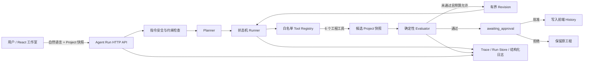
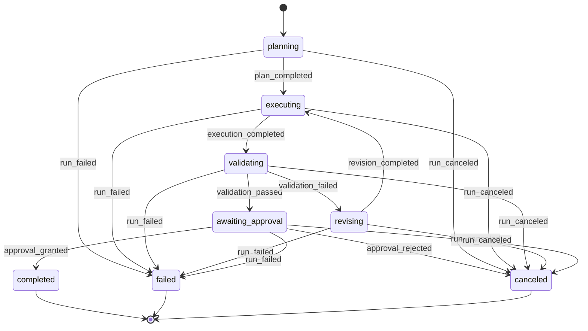

# Audio Director Agent：当前架构与状态机

这份文档描述当前已经落地的实现。Day 1 的历史基线仍保留在 [`00-current-architecture.md`](00-current-architecture.md)，不要把两者混为一谈。

## 为什么这样设计

- **问题**：自然语言音乐需求含糊，而直接生成不可编辑音频无法解释“改了什么”，也很难验证时长、轨道和音符约束。
- **决策**：Agent 只操作结构化 `Project` 快照；执行前检查指令，只能调用注册表中的白名单工具，执行后由确定性评估器验收，候选结果必须经过人工审批。
- **证据**：每个 Run 都有状态、Trace、源快照与候选快照；固定离线 Eval 覆盖创建、修改、约束、冲突和提示词注入，并输出机器可读结果。
- **取舍**：修订次数和工具预算有上限，系统会放弃一部分“继续试也许能成功”的机会，以换取可预测的时间、成本和失败方式。

## 系统架构



这里最重要的数据边界是：工具在候选快照上工作，当前工程不会因为 Agent 运行而直接改变。只有 `awaiting_approval` 状态下用户明确批准，前端才把候选工程写入 History；拒绝、冲突、安全拦截和执行失败都保留原工程。

| 组件 | 单一职责 | 可检查证据 |
| --- | --- | --- |
| 指令安全与约束检查 | 在工具执行前拒绝注入和相互冲突的约束 | `unsafe_instruction` / `conflicting_constraints` |
| Planner | 把意图变成有限工具步骤 | Trace 中的计划与 Tool Call |
| Tool Registry | 暴露 6 个工程级白名单工具并校验参数 | 工具名、状态、输入摘要 |
| Evaluator | 用确定性断言检查结构、约束和可导出性 | Evaluation 结果与失败原因 |
| Revision | 只根据评估反馈进行有限次纠正 | 修订次数与前后 Trace |
| Review / Approval | 展示差异，把最终写入权留给用户 | `approval_granted` / `approval_rejected` |

## Run 状态机



`completed`、`failed`、`canceled` 是不可再迁移的终态。运行通过验证并不等于已经修改工程：它先停在 `awaiting_approval`，这是 Agent 自主执行与用户最终控制之间的硬边界。

## 为什么不使用多 Agent

当前任务只有一个共享的 `Project` 状态，规划、工具执行与确定性验收也都有清晰接口，并不存在必须由多个自治角色并行探索的子问题。多 Agent 会额外引入：候选快照同步、角色意见仲裁、更多模型调用与更长延迟，而且现有 Eval 没有证明这些成本能换来更高成功率。

因此当前选择“单 Agent + Tool Registry + Evaluator + 有界 Revision”。将来只有在出现可独立评测、可并行且确实提高指标的角色（例如编曲与混音分离）时，才考虑拆分，并用同一套 Eval 做前后对照。

## 如何复现证据

在仓库根目录运行：

```powershell
npm run eval:agent
npm run verify
```

第一条命令会同时更新根 README 的指标区块、[完整 Eval 报告](../../server/src/agent/evals/reports/README.md)和[机器可读基线](../../server/src/agent/evals/reports/baseline.json)；第二条命令验证类型、代码规范、测试和构建。资源与权限边界见 [`security.md`](security.md)。
